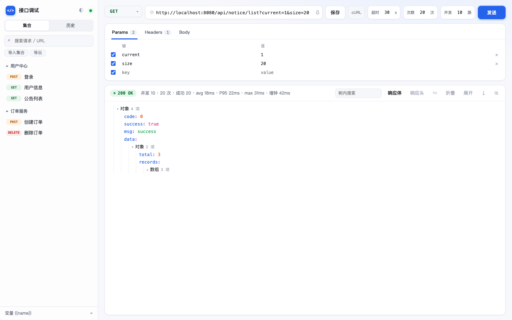
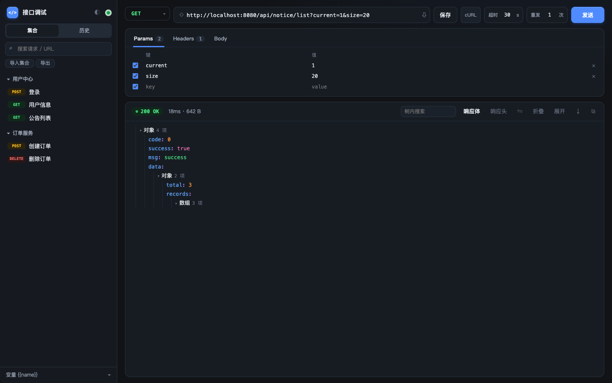

# 接口调试 · api-tool

一个跑在本机的轻量接口调试工具——单文件前端 + 本地反代，浏览器和桌面双形态，7MB，无云、无账号、数据不出本机。



<details>
<summary>暗色主题</summary>



</details>

## 为什么不用 Postman

| | 本项目 | Postman |
|---|---|---|
| 体积 | 7 MB（桌面版） | 500 MB+ |
| 数据 | 本地 JSON 文件 | 默认上传云端 |
| 登录 / 账号 | 不需要 | 需要 |
| 跨域请求 | 内置本地反代 | 需装桌面版 |
| JWT 过期提醒 | 内置 | 需写脚本 |
| 团队协作 | 导出 JSON 互发 | 工作区同步 |

个人调试场景够用；团队协作、Mock、定时监控这些刻意没做。

## 功能

**请求**
- GET / POST / PUT / PATCH / DELETE / HEAD，Params 与 URL 双向同步
- Headers 键值编辑、常用 Header 一键填充、body 支持 JSON / form / raw
- `{{变量}}` 占位符，发送前自动替换
- 超时时间可调，发送中可随时「停止」
- 批量发送：总次数 + 并发数可配，输出 avg / P95 / max / 墙钟耗时；并发 1 即串行重试，并发 >1 可做并发压测
- 粘贴 cURL 直接导入（地址栏或页面任意处 ⌘V）
- 一键把当前请求复制为 cURL 命令

**响应**
- JSON 折叠树（超大结构按预算截断，不卡界面）
- 树内搜索：命中高亮 + 自动展开所在层级
- 点击任意值「⤓」存为环境变量，登录 token 一键复用
- 响应头表格、下载、复制
- 两次响应的 JSON 差异对比（按路径列出增 / 删 / 改）
- 重定向后显示最终落点 URL

**集合与环境**
- 分组管理请求，可搜索
- 分组「▶」批量回归：顺序跑完整个分组，按状态码断言，输出汇总表
- 多环境变量，一键切换（开发 / 测试 / 预发…）
- 导出 / 导入集合，兼容 Postman Collection v2 格式
- 历史记录自动去重，可一键清空
- 草稿自动保存，刷新 / 重启不丢

**细节**
- 自动解析 JWT `exp`，过期或 30 分钟内到期时在 Headers 页签标红 / 黄
- 发送前校验请求头字符集（HTTP 头只能是 Latin-1），错误定位到具体字符
- 浅色 / 暗色主题，默认跟随系统
- 快捷键：`⌘↵` 发送、`⌘S` 保存

## 快速开始

### 浏览器版

```bash
node server.mjs          # → http://127.0.0.1:8799
```

零依赖，Node 18+。

### 桌面版（Tauri）

```bash
cd desktop
npm install
npm run dev              # 开发模式
npm run deploy           # 构建 + 安装到 /Applications + 重启
```

产物：`desktop/src-tauri/target/release/bundle/macos/接口调试.app`

需要 Rust 工具链。窗口使用 macOS 原生毛玻璃材质。

## 数据

| 版本 | 位置 |
|---|---|
| 浏览器版 | `./data.json` |
| 桌面版 | `~/Library/Application Support/local.api-tool/data.json` |

- 写入采用 tmp + rename 原子操作，崩溃不会损坏文件
- 首次启动以 `data.example.json` 播种，不含任何凭证
- `data.json` 已在 `.gitignore` 中（内含登录 token，不要提交）

**注意**：导出的集合 JSON 和环境变量可能含 token，分享前自行脱敏。

## 安全边界

- 本地 API 只接受 `127.0.0.1` / `localhost` 的 `Host` 与 `Origin`，防止浏览器中的恶意网页把本机当作内网跳板
- 反代不做任何内容落盘，请求与响应只在内存中中转
- 请求头过滤 `Host` / `Origin` / `Referer` / `User-Agent` 等由本机决定的字段

## 自检

```bash
node server.mjs --selftest
```

覆盖：状态读写、代理往返、非法请求头拦截、超时中断、主动取消、重定向落点、来源校验。

## 结构

```
index.html              前端全部逻辑（HTML + CSS + JS 单文件）
server.mjs              浏览器版服务：静态页 + 反代 + 状态持久化
data.example.json       桌面版首次启动种子数据
data.json               本地数据（gitignore）
docs/                   README 截图
desktop/
  src-tauri/src/main.rs 桌面版：axum 同构 API + reqwest 代理 + 毛玻璃窗口
  src-tauri/tauri.conf.json
```

浏览器版与桌面版共用同一份 `index.html`：桌面版在编译期将其嵌入二进制，通过内嵌的 axum 服务提供同等 API。

## License

MIT
